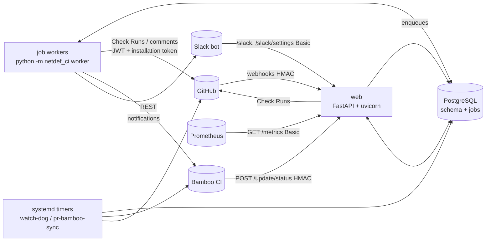
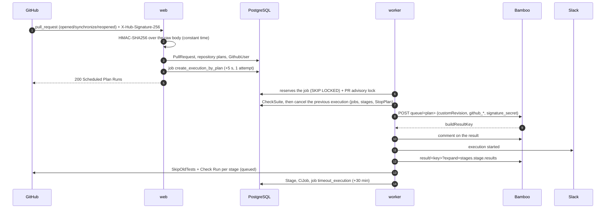
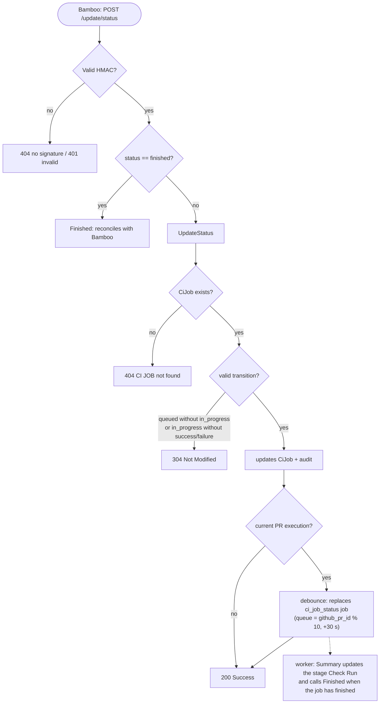
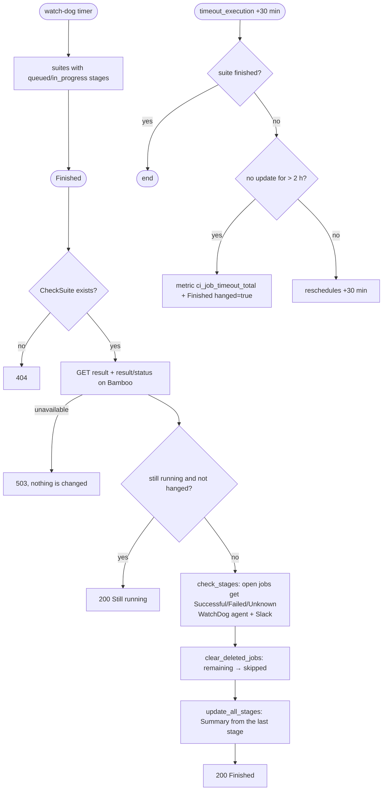
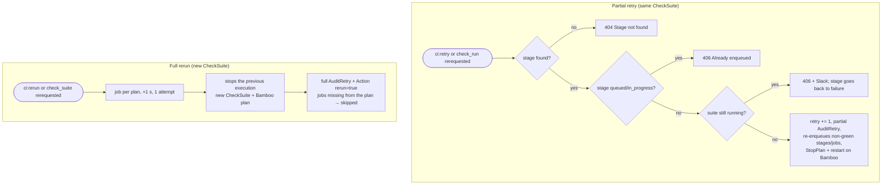

# 01 — Overview, architecture and structure

## Purpose and scope

`netdef-ci-github-app-python` is a standalone Python service. It connects **GitHub
Pull Requests** to an **Atlassian Bamboo CI** server:

1. receives GitHub events (PR opened/updated, `ci:retry` / `ci:rerun` comments, re-run from the Checks UI);
2. triggers a Bamboo plan for each plan configured for the repository;
3. creates and maintains GitHub **Check Runs** (one per *stage*) reflecting job progress;
4. receives Bamboo *callbacks* (`POST /update/status`) and reconciles state in the background (WatchDog, timeout);
5. notifies users on Slack and exposes Prometheus metrics.

Out of scope: ad-hoc report scripts and Redis-based queues (see `12-limitations-and-pending.md` and `09-operations.md`).

## Architecture



| Component         | Responsibility                                                                                                                                | Code                            |
|-------------------|-----------------------------------------------------------------------------------------------------------------------------------------------|---------------------------------|
| **web**           | Authenticates (HMAC/Basic), validates the raw body, delegates to the service and responds. Makes no slow external calls: it enqueues jobs.    | `web/app.py`, `web/webhooks.py` |
| **services**      | Business rules (BuildPlan, UpdateStatus, Summary, Finished, executions, retry, rerun, tasks).                                | `services/`                     |
| **clients**       | GitHub App (JWT, installation token with caching/renewal), Bamboo REST, Slack bot; bounded retries.                                           | `clients/`                      |
| **jobs**          | PostgreSQL queue (`run_at`, named/numeric queues, 5 attempts, 5 min lock); worker; per-PR locks.                   | `jobs/`                         |
| **models**        | SQLAlchemy models over the schema (including the `jobs` and `webhook_deliveries` tables).                                                | `models.py`, `migrations/`      |
| **cli**           | `worker`, `watch-dog`, `pr-bamboo-sync`, `single-sync`, `migrate`, `check-config`, organizations/users console.                               | `cli/main.py`                   |
| **observability** | Logs with secret redaction, Prometheus metrics (multiprocess), `/healthz`, `/readyz`.                                                         | `logs.py`, `metrics.py`         |

## Main flows

### Pull Request webhook → Bamboo execution



### Bamboo status callback and consolidation



### Reconciliation (`Finished`), timeout and WatchDog



### `ci:retry` × `ci:rerun`



## Directory structure

```
netdef-ci-github-app-python/
├── README.md  AGENTS.md  PLAN.md  Makefile
├── requirements.txt  requirements-dev.txt        # pinned dependencies
├── .env.example  github_apps.example.toml        # dummy configuration
├── alembic.ini  migrations/versions/             # 0001 initial schema, 0002 jobs and webhook tables
├── src/netdef_ci/
│   ├── config.py  db.py  models.py  enums.py  security.py  logs.py  metrics.py  container.py
│   ├── web/{app.py,webhooks.py}
│   ├── clients/{github.py,bamboo.py,slack.py,http.py}
│   ├── jobs/{queue.py,handlers.py,registry.py,locks.py}
│   ├── services/{build_plan,update_status,summary,finished,executions,rerun,retry,tasks,...}.py
│   └── cli/main.py
├── tests/{unit,integration,fakes.py,factories.py,payloads.py}
├── scripts/{smoke_test.py,test-with-podman.sh,freeze_requirements.sh,Containerfile.dev}
├── deploy/ansible/{ansible.cfg,inventories/{dev,prod},playbooks,roles/{python_runtime,netdef_ci}}
└── doc/
```

## Python version and dependencies

Python **3.15.2** (details and rationale in `03-technical-decisions.md`). Direct dependencies: FastAPI, uvicorn,
SQLAlchemy, Alembic, psycopg, httpx, PyJWT (+cryptography), pydantic-settings, prometheus-client — all pinned in
`requirements.txt` along with the transitive ones.
