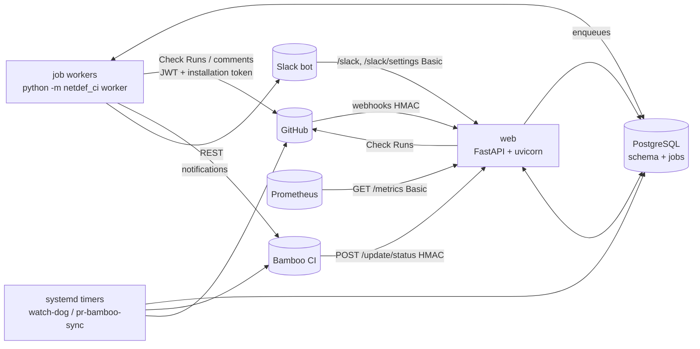
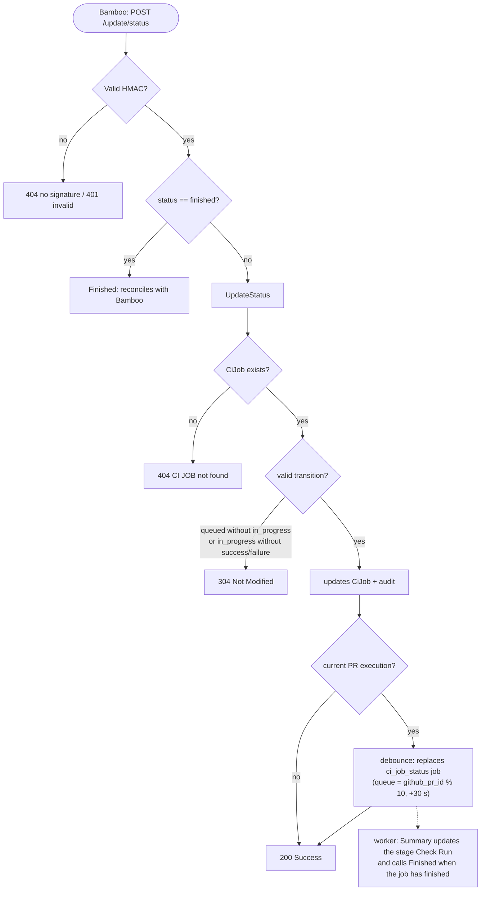
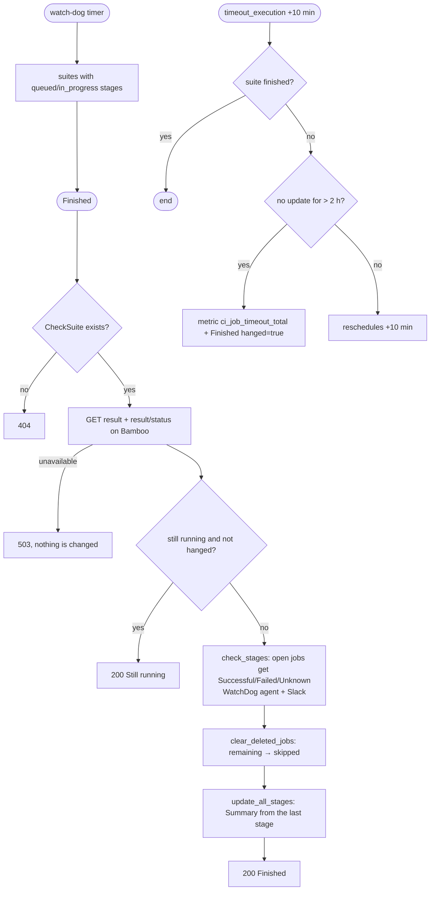
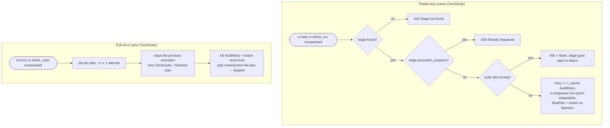

# 01 — Overview, architecture and structure

## Purpose and scope

`netdef-ci-github-app-python` is a standalone Python service. It connects **GitHub
Pull Requests** to an **Atlassian Bamboo CI** server:

1. receives GitHub events (PR opened/updated, `ci:retry` / `ci:rerun` comments, re-run from the Checks UI);
2. triggers a Bamboo plan for each plan configured for the repository;
3. creates and maintains GitHub **Check Runs** (one per *stage*) reflecting job progress;
4. receives Bamboo *callbacks* (`POST /update/status`) and reconciles state in the background (WatchDog, timeout);
5. notifies users on Slack and exposes Prometheus metrics.

Out of scope: ad-hoc report scripts and Redis-based queues (see `12-limitations-and-pending.md` and `09-operations.md`).

## Architecture



| Component     | Responsibility                                                                                                                                                                                     | Code                                   |
|---------------|----------------------------------------------------------------------------------------------------------------------------------------------------------------------------------------------------|----------------------------------------|
| **app**       | Authenticates (HMAC/Basic), validates the raw body, delegates to the flow and responds. Makes no slow external calls: it enqueues jobs.                                                            | `app/github_app.py`, `app/webhooks.py` |
| **github**    | GitHub-driven flows: build plan, status updates, stages/CI jobs/check runs (`build/`), `ci:retry` (`retry/`), `ci:rerun` (`re_run/`), end of a build (`plan_execution/`), duplicate request guard. | `github/`                              |
| **bamboo_ci** | Bamboo plan flows on top of the client: start a plan with its variables, wait for its jobs, stop the previous execution.                                                                           | `bamboo_ci/`                           |
| **slack**     | Slack slash commands (`running`, `settings`, `subscribe`).                                                                                                                                         | `slack/`                               |
| **workers**   | One module per background job, named after the Ruby worker: the job-side flow plus its `@job_handler` function.                                                                                    | `workers/`                             |
| **clients**   | GitHub App (JWT, installation token with caching/renewal), Bamboo REST, Slack bot; bounded retries.                                                                                                | `clients/`                             |
| **jobs**      | PostgreSQL queue (`run_at`, named/numeric queues, 5 attempts, 5 min lock); worker loop; per-PR locks.                                                                                              | `jobs/`                                |
| **models**    | SQLAlchemy models over the schema, one module per table (including `jobs` and `webhook_deliveries`).                                                                                               | `models/`, `migrations/`               |
| **helpers**   | Settings, logs with secret redaction, Prometheus metrics (multiprocess), database sessions, HMAC/Basic checks, payload reading.                                                                    | `helpers/`                             |
| **cli**       | `worker`, `watch-dog`, `pr-bamboo-sync`, `single-sync`, `migrate`, `check-config`, organizations/users console.                                                                                    | `cli/main.py`                          |

## Main flows

### Pull Request webhook → Bamboo execution

```mermaid
sequenceDiagram
    autonumber
    participant GH as GitHub
    participant WEB as web
    participant DB as PostgreSQL
    participant W as worker
    participant B as Bamboo
    participant SL as Slack
    GH->>WEB: pull_request (opened/synchronize/reopened) + X-Hub-Signature-256
    WEB->>WEB: HMAC-SHA256 over the raw body (constant time)
    WEB->>DB: PullRequest, repository plans, GithubUser
    WEB->>DB: job create_execution_by_plan (+5 s, 1 attempt)
    WEB-->>GH: 200 Scheduled Plan Runs
    W->>DB: reserves the job (SKIP LOCKED) + PR advisory lock
    W->>GH: authenticate (failure: nothing saved, job enqueued again)
    W->>DB: CheckSuite; previous execution's running jobs cancelled
    W->>B: StopPlan of the previous execution, wait until stopped
    W->>B: POST queue/<plan> (customRevision, github_*, signature_secret)
    B-->>W: buildResultKey
    W->>B: comment on the result
    Note over W,GH: GitHub setup (ChecksSetup); any error → job setup_github_checks
    W->>SL: execution started
    W->>GH: cancel the previous execution's open check runs
    W->>B: result/<key>?expand=stages.stage.results
    W->>GH: SkipOldTests + Check Run per stage (queued, output in the POST)
    W->>DB: Stage, CiJob, job timeout_execution (+10 min)
```

### Bamboo status callback and consolidation



### Reconciliation (`Finished`), timeout and WatchDog



### `ci:retry` × `ci:rerun`



## Directory structure

```
netdef-ci-github-app-python/
├── README.md  AGENTS.md  Makefile
├── requirements.txt  requirements-dev.txt        # pinned dependencies
├── .env.example  github_apps.example.toml        # dummy configuration
├── alembic.ini  migrations/versions/             # 0001 initial schema, 0002 jobs and webhook tables
├── src/netdef_ci/                                 # same grouping as the Ruby application (map below)
│   ├── app/{github_app.py,webhooks.py}           # app/github_app.rb
│   ├── github/{build/,retry/,re_run/,plan_execution/,parsers/,topotest_failures/,build_plan.py,update_status.py,...}
│   ├── bamboo_ci/{plan_run.py,running_plan.py,stop_plan.py}
│   ├── slack/{running.py,settings.py,subscribe.py}
│   ├── workers/{create_execution_by_plan.py,ci_job_status.py,watch_dog.py,...,loader_workers.py}
│   ├── models/{check_suite.py,ci_job.py,stage.py,pull_request.py,...}
│   ├── helpers/{config.py,logs.py,metrics.py,db.py,security.py,payload.py}
│   ├── clients/{github.py,bamboo.py,slack.py,http.py}   # HTTP only (Ruby: lib/github/check.rb, lib/bamboo_ci/api.rb, lib/slack_bot/)
│   ├── jobs/{queue.py,registry.py,locks.py}       # replaces Delayed Job
│   ├── container.py  enums.py
│   └── cli/main.py
├── tests/{unit,integration,fakes.py,factories.py,payloads.py}
├── scripts/{smoke_test.py,test-with-podman.sh,freeze_requirements.sh,Containerfile.dev}
├── deploy/ansible/{ansible.cfg,inventories/{dev,prod_frr_public,prod_private},playbooks,roles/{python_runtime,netdef_ci}}
└── doc/
```

## Ruby → Python map

The package follows the directory structure of the Ruby application, so a Ruby file is found under the same name.
Three differences are deliberate (see `07-design-notes.md`): HTTP calls stay in `clients/` (Ruby mixes them into
`lib/github/check.rb` and `lib/bamboo_ci/*.rb`), the queue is the application's own (`jobs/`, instead of Delayed Job),
and a few Ruby files were split or merged where Python names would clash.

| Ruby                                                                                                                  | Python (`src/netdef_ci/`)                                                                            |
|-----------------------------------------------------------------------------------------------------------------------|------------------------------------------------------------------------------------------------------|
| `app/github_app.rb`                                                                                                   | `app/github_app.py` (routes), `app/webhooks.py` (delivery de-duplication and dispatch)               |
| `lib/github/build_plan.rb`                                                                                            | `github/build_plan.py`                                                                               |
| `lib/github/update_status.rb`                                                                                         | `github/update_status.py`                                                                            |
| `lib/github/user_info.rb`                                                                                             | `github/user_info.py`                                                                                |
| `lib/github/duplicate_request_guard.rb`                                                                               | `github/duplicate_request_guard.py` (`CommandGuard`)                                                 |
| `lib/github/check.rb`                                                                                                 | `clients/github.py` (`GithubCheck`)                                                                  |
| `lib/github/build/action.rb`, `checks_setup.rb`, `retry.rb`, `skip_old_tests.rb`, `summary.rb`, `unavailable_jobs.rb` | `github/build/` (same names)                                                                         |
| `lib/github/build/summary/message_formatter.rb`                                                                       | `github/build/message_formatter.py`                                                                  |
| `lib/github/build/plan_run.rb`                                                                                        | `github/build_plan.py` (together with `Github::BuildPlan`)                                           |
| `lib/github/parsers/pull_request_commit.rb`                                                                           | `github/parsers/pull_request_commit.py`                                                              |
| `lib/github/plan_execution/finished.rb`                                                                               | `github/plan_execution/finished.py`                                                                  |
| `lib/github/re_run/{base,command,comment}.rb`                                                                         | `github/re_run/{base,command,comment}.py`                                                            |
| `lib/github/retry/{base,command,comment}.rb`                                                                          | `github/retry/{base,command,comment}.py`                                                             |
| `lib/github/topotest_failures/retrieve_error.rb`                                                                      | `github/topotest_failures/retrieve_error.py`                                                         |
| `lib/bamboo_ci/plan_run.rb`                                                                                           | `bamboo_ci/plan_run.py`                                                                              |
| `lib/bamboo_ci/running_plan.rb`                                                                                       | `bamboo_ci/running_plan.py` (waiting) and `clients/bamboo.py` (HTTP)                                 |
| `lib/bamboo_ci/stop_plan.rb`                                                                                          | `bamboo_ci/stop_plan.py` (waiting, stopped suite) and `clients/bamboo.py` (HTTP, comment)            |
| `lib/bamboo_ci/api.rb`, `download.rb`, `result.rb`, `retry.rb`, `lib/helpers/request.rb`                              | `clients/bamboo.py`, `clients/bamboo_auth.py`, `clients/http.py`                                     |
| `lib/slack/{running,settings,subscribe}.rb`                                                                           | `slack/{running,settings,subscribe}.py`                                                              |
| `lib/slack_bot/slack_bot.rb`                                                                                          | `clients/slack.py`                                                                                   |
| `lib/models/*.rb`                                                                                                     | `models/*.py` (same names; `job.py` and `webhook_delivery.py` are Python only)                       |
| `lib/helpers/configuration.rb`                                                                                        | `helpers/config.py`                                                                                  |
| `lib/helpers/github_logger.rb`                                                                                        | `helpers/logs.py`                                                                                    |
| `lib/helpers/prometheus_metrics*.rb`                                                                                  | `helpers/metrics.py`                                                                                 |
| `lib/helpers/sinatra_payload.rb`                                                                                      | `helpers/payload.py`                                                                                 |
| `database_loader.rb`, `config/delayed_job.rb`                                                                         | `helpers/db.py`, `jobs/queue.py`                                                                     |
| `workers/<name>.rb`                                                                                                   | `workers/<name>.py`: the same flow plus its `@job_handler` function                                  |
| `workers/loader_workers.rb`                                                                                           | `workers/loader_workers.py` (imports every worker so its job is registered)                          |
| `Github::PlanExecution::Finished` and `Github::Retry::*`, run inside the request                                      | `workers/finished_execution.py`, `workers/retry_execution.py` (background jobs; no Ruby worker file) |
| `CreateExecutionByPlan.setup_github_checks`                                                                           | job `setup_github_checks`, registered in `workers/create_execution_by_plan.py`                       |
| `db/migrate/*.rb`                                                                                                     | `migrations/versions/*.py` (Alembic)                                                                 |
| `reports/*.rb`, `tasks/*.rb`                                                                                          | not ported; organizations and users are managed with `cli/main.py` (`org`, `user`)                   |


## Python version and dependencies

Python **3.13** (3.13.18; details and rationale in `03-technical-decisions.md`). Direct dependencies: FastAPI, uvicorn,
SQLAlchemy, Alembic, psycopg, httpx, PyJWT (+cryptography), pydantic-settings, prometheus-client — all pinned in
`requirements.txt` along with the transitive ones.
