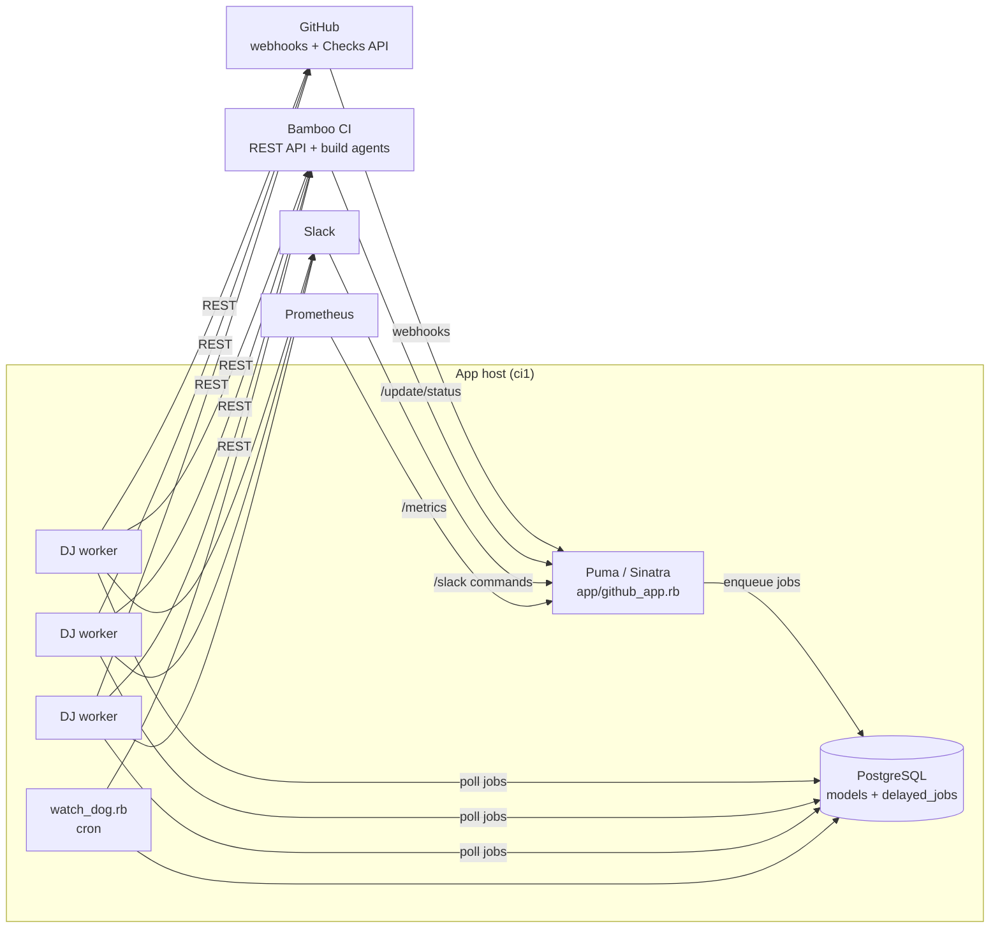
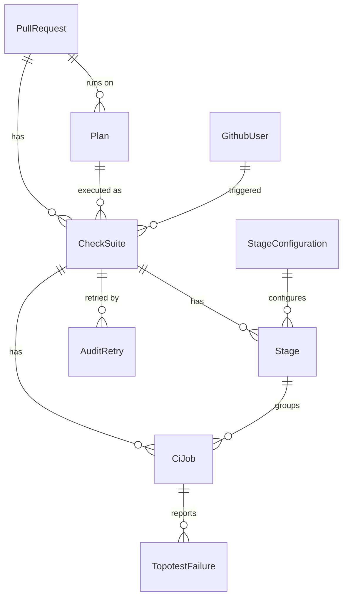
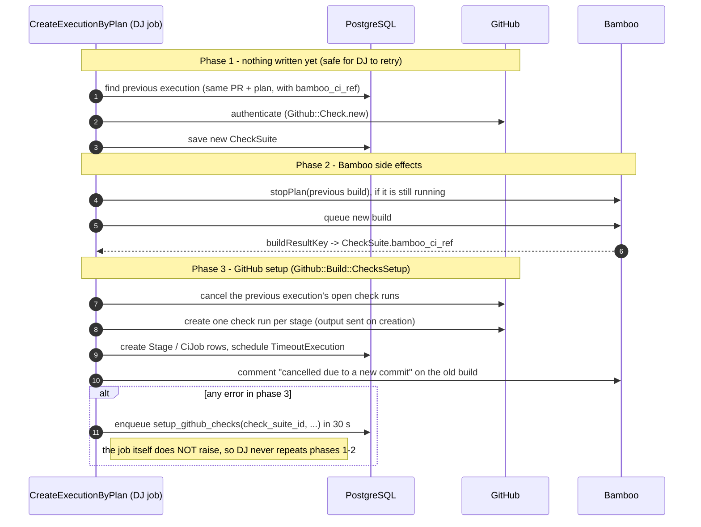

# Architecture

This page is for developers who are new to **netdef-ci-github-app**. It explains what the system does, how its
parts fit together, how the main flows work, and the failure-handling rules every change has to keep. For coding
conventions, see [`AGENTS.md`](../../AGENTS.md). For the meaning of each check state, see [`doc/ci/ci.md`](../ci/ci.md).

## 1. What the system does

The app connects GitHub pull requests to the Bamboo CI used by FRRouting:

1. When a PR is opened, reopened or receives a push, GitHub sends a webhook.
2. The app starts a Bamboo build (a *plan run*) for that commit and stops the PR's previous build if one is still
   running.
3. It creates a GitHub **check run** for each CI *stage* (Build, Basic Tests, Verify Source, ...), so the PR shows
   the CI progress.
4. While Bamboo runs, the build scripts call back the app (`/update/status`). The app updates its database, the
   GitHub check runs and their summaries.
5. Developers can ask for a new run from the PR: `ci:retry` re-runs only the failed jobs, and `ci:rerun` starts a
   full new build.
6. Subscribed users get Slack notifications when an execution starts or finishes.

## 2. Components and processes



| Process | Started by | Role |
|---|---|---|
| Puma + Sinatra (`app/github_app.rb`) | `config.ru` (systemd unit `githubcheck`) | Receives HTTP requests, authenticates them and delegates to `lib/`. Routes should not hold business logic. |
| 3 × Delayed Job workers (`rake jobs:work`) | Spawned by `config.ru` | Run background jobs stored in the `delayed_jobs` table. |
| `workers/watch_dog.rb` | `bin/watch_dog_prod.sh` (cron) | Finds executions that look stuck and finishes them from the Bamboo result. |
| PostgreSQL | external | All state: PRs, check suites, stages, jobs, audit trail and the job queue. |

Worker stdout and stderr (including Delayed Job's `FAILED ... with <exception>` lines) go to the **systemd
journal** (`journalctl -u githubcheck`), not to `logs/`. See [Observability](#7-observability).

## 3. Code layout

```
app/github_app.rb        HTTP routes only
lib/bamboo_ci/           Bamboo REST calls (PlanRun, StopPlan, RunningPlan, Retry, Result, ...)
lib/github/              GitHub webhook handlers and the Checks API wrapper (Github::Check)
  build_plan.rb            pull_request webhook entry point
  build/                   execution set-up: PlanRun (scheduling), ChecksSetup, Action, Summary, ...
  retry/                   ci:retry and check_run "Re-run" (partial re-run of failed jobs)
  re_run/                  ci:rerun and check_suite "Re-run all" (full new execution)
  plan_execution/          Finished: closes an execution when Bamboo says it is done
  update_status.rb         per-job status callbacks from Bamboo
lib/models/              ActiveRecord models
lib/slack/, slack_bot/   Slack commands and notifications
lib/helpers/             configuration, logging, Prometheus metrics
workers/                 Delayed Job entry points (thin; delegate to lib/)
config/delayed_job.rb    worker settings (max_attempts = 5, sleep_delay = 5 s, max_run_time = 5 min)
```

## 4. Data model



| Model | Meaning |
|---|---|
| `PullRequest` | A GitHub PR (`github_pr_id`, `repository`). Has one or more `Plan`s. |
| `Plan` | A Bamboo plan the PR runs on (`bamboo_ci_plan_name`, e.g. `FRR-PULLREQ3`). |
| `CheckSuite` | **One execution** of a plan for one commit. `bamboo_ci_ref` is the Bamboo build key (`FRR-PULLREQ3-24204`); it is set only once Bamboo accepts the build. `cancelled_previous_check_suite_id` and `stopped_in_stage` record which execution it replaced. |
| `Stage` | A group of jobs shown as **one GitHub check run** (`check_ref` is the check run id). Its behaviour comes from `StageConfiguration` (`start_in_progress`, `can_retry`, `position`). |
| `CiJob` | One Bamboo job (`job_ref`). Jobs do not have their own check runs; they are listed in the stage summary. |
| `AuditStatus` | History of every status change of stages and jobs. |
| `AuditRetry` | Who asked for a retry or rerun, and of which type. |
| `TopotestFailure` | Parsed test failures attached to a job. |
| `GithubUser`, `Organization`, `PullRequestSubscription` | Users, organizations and Slack subscriptions. |

Statuses (shared by `Stage`, `CiJob` and `AuditStatus`): `queued`, `in_progress`, `success`, `failure`,
`cancelled`, `skipped`.

## 5. Main flows

### 5.1 New push on a PR (`pull_request` opened / synchronize / reopened)

`Github::BuildPlan` accepts only `opened`, `synchronize` and `reopened`; other actions (for example `labeled`)
return 405. `Github::Build::PlanRun` then enqueues one `CreateExecutionByPlan.create` job per plan, 5 s later, on
the `create_execution_by_plan` queue. The job runs in **three phases**:



The reasons for this split are explained in [section 6](#6-failure-handling-and-idempotency-read-this-before-changing-a-job).

### 5.2 Progress callbacks from Bamboo (`POST /update/status`)

Bamboo's build scripts (`ci/github_checks/*.sh` in the FRR repository) post the status of each job. The request is
signed (`signature_secret` is passed to the build as a Bamboo variable).

- `status != finished` → `Github::UpdateStatus` updates the `CiJob` (`in_progress`, `success` or `failure`; failures
  are parsed into `TopotestFailure`). It then schedules a `CiJobStatus.update` job on queue `github_pr_id % 10`,
  30 s later, replacing the pending one for the same execution. That job rebuilds the stage summaries
  (`Github::Build::Summary`): it moves a stage to `in_progress`, closes it as `success` or `failure`, and cancels
  later stages when an earlier one fails.
- `status == finished` → `Github::PlanExecution::Finished` reads the final result from Bamboo, closes everything that
  is still open and sends the "finished" Slack notification.

### 5.3 `ci:retry` and the check run "Re-run" button (partial re-run)

`Github::Retry::Comment` (PR comment) or `Github::Retry::Command` (`check_run rerequested`) **reuses the same
CheckSuite**. It re-queues only the failed jobs (`BambooCi::Retry.restart`), puts their stages back to queued and
reacts 👍 on the comment. This runs synchronously inside the request.

Duplicate requests are dropped by `Github::DuplicateRequestGuard` (see [6.4](#64-duplicate-retry--rerun-requests)).

### 5.4 `ci:rerun` and the check suite "Re-run all" button (full re-run)

`Github::ReRun::Comment` or `Github::ReRun::Command` validates the request and enqueues `CreateExecutionByComment` or
`CreateExecutionByCommand`. These jobs stop the running executions, start a new Bamboo build on a **new
CheckSuite**, and create its checks. Duplicate requests are dropped by `Github::DuplicateRequestGuard` before
anything is enqueued. ⚠️ The jobs do not follow the three-phase pattern yet (see
[Known gaps](#8-known-gaps-and-pitfalls)).

### 5.5 Stuck executions

- `TimeoutExecution` (queue `timeout_execution`) checks each execution every 30 minutes. If no job was updated for
  2 hours, it calls `Finished` with `hanged: true`.
- `watch_dog.rb` (cron) does the same in bulk for executions that look stale.
- `PrBambooSync` cross-checks GitHub check runs, the database and Bamboo, and reports mismatches.

## 6. Failure handling and idempotency (read this before changing a job)

### 6.1 Why it matters

Delayed Job **re-runs the whole job** when it raises (up to 5 attempts; waits of about 6 s, 21 s, 86 s, and so on).
A job that starts or stops a Bamboo build is **not idempotent**: running it again starts or stops a different build.

Incident of 2026-11-09 (before the fix):

- GitHub answered `404` to the first update of a check run created about 1 s earlier (read-after-write lag). This
  happened in about 1% of jobs on normal days and about 10% that day. DNS failures and timeouts to
  `api.github.com` happened too.
- Each error made Delayed Job repeat the job:
  - **Error after the Bamboo start:** the retry stopped the build that had just started. Bamboo reports that stop as
    `FATAL Failed to prepare the build`, which raised false alerts.
  - **Error before the Bamboo start:** the retry left orphan CheckSuites and **never stopped** the previous build.
    PR 8118 ran two full builds of the same commit in parallel.

### 6.2 Rules

1. **Talk to GitHub before writing anything** (phase 1). An error then leaves nothing behind, so a retry is harmless.
2. **Phase 2 only touches Bamboo.** The previous build is stopped in Bamboo *before* its GitHub checks are cancelled.
   If the stop fails, the previous execution still looks open and the retry stops it again.
3. **After Bamboo has started, nothing may raise into Delayed Job.** `CreateExecutionByPlan#setup_github_checks`
   rescues every error, logs it to `github_app.log` (`GitHub Checks setup failed ... - rescheduling`) and enqueues
   `CreateExecutionByPlan.setup_github_checks`. That job is GitHub-only and idempotent, so normal Delayed Job retries
   are safe for it.
4. **Resume mode** (`ChecksSetup` with `resume: true`, `Action#create_summary(resume: true)`) completes a
   half-finished setup and never duplicates anything:
   - a stage without `check_ref` gets its check run, and a `start_in_progress` stage is moved to in progress;
   - existing `CiJob` rows (same `job_ref`) are kept;
   - the Slack notification is not sent again, and the Bamboo comment is posted once (guarded by
     `cancelled_previous_check_suite_id`);
   - if a newer execution with a Bamboo build exists for the same PR and plan, it does nothing.
5. **Choosing the "previous execution"**: only CheckSuites **with a `bamboo_ci_ref`** count, because suites without
   one never started a build. A suite that has a Bamboo build but no stages and no jobs counts as **running**: its
   GitHub setup died, but the build is still running in Bamboo.

### 6.3 GitHub Checks API quirks

| Quirk | How the code deals with it |
|---|---|
| A check run created a moment ago may answer `404` to an update | `Github::Check#create(name, output:)` sends the output with the creation request, so `Stage#enqueue` makes no update right after. A new check run is already `queued`. |
| The same lag on later updates | `basic_status` (`queued` / `in_progress`) retries `Octokit::NotFound` 3 times (2, 4 and 6 s) and then raises. `completed` (`success` / `failure` / `cancelled` / `skipped`) retries `NotFound` 3 times (5, 10 and 15 s) and then gives up with `{}`. |
| Check runs cannot be deleted | Superseded or broken check runs are concluded as `cancelled` or `skipped` (`SkipOldTests`), never removed. |

### 6.4 Duplicate retry / rerun requests

Several triggers for the same target can arrive within a few seconds: repeated comments, GitHub firing one
`check_run rerequested` per check run on "Re-run", or webhook redeliveries. Each trigger would stop and start Bamboo,
so a late duplicate could cancel the execution the first trigger had just started. `Github::DuplicateRequestGuard`
lets only one of them through within a **60 s window**. It does so with a single conditional `UPDATE`, which works
across Puma workers:

| Trigger | Claimed column |
|---|---|
| `ci:retry`, `check_run rerequested` | `check_suites.retry_requested_at` |
| `ci:rerun`, `check_suite rerequested` | `pull_requests.rerun_requested_at` |

Duplicates answer `202` and do not touch Bamboo. The guard protects against **repeated triggers**. Section 6.2
protects against a **single trigger whose job is retried**. Both are needed.

### 6.5 Checklist for a new job

- Does it start or stop something in Bamboo? Then everything after that side effect must not raise. Split the work
  as `CreateExecutionByPlan` and `ChecksSetup` do.
- Can it run twice? Write the test that runs it twice (or simulates a failure half-way) and checks that no row or
  external call is duplicated.
- Log the exception class and message to a file in `logs/`, not only to stdout.

## 7. Observability

| Where | What you find |
|---|---|
| `logs/github_app.log` | Webhooks received, `BambooCi::PlanRun - CheckSuite ...`, `Building action to CheckSuite ...`, GitHub setup reschedules. |
| `logs/github_check_api.log` | Every Checks API update (`basic_status: <id> ...`, `completed: ...`, `not found at GitHub - retry N`). |
| `logs/pr<NUMBER>.log` | Everything about one PR's execution set-up. |
| `logs/github_update_status.log`, `ci_job_status.log`, `github_plan_execution_finished.log` | Bamboo callbacks and summaries. |
| `logs/github_retry.log`, `github_rerun_*.log` | Retry and rerun requests. |
| `journalctl -u githubcheck` | Delayed Job lifecycle: `RUNNING`, `COMPLETED after N`, `FAILED (n prior attempts) with <Exception>`. Timestamps are flush times (stdout is buffered). |
| `GET /metrics` | Prometheus metrics (`lib/helpers/prometheus_metrics.rb`): HTTP, Bamboo calls, retries, timeouts, Delayed Job gauges. Dashboard: `grafana_dashboard.json`. |

Useful queries when something looks wrong with a PR:

```ruby
# bin/console production
pr = PullRequest.find_by(github_pr_id: 8118)
pr.check_suites.last(5).map { |cs| [cs.id, cs.plan_id, cs.bamboo_ci_ref, cs.stages.count, cs.ci_jobs.count] }
```

A CheckSuite with `bamboo_ci_ref` but zero stages means a GitHub setup that has not finished. Look for its
`setup_github_checks` job in `delayed_jobs` and for the reschedule line in `github_app.log`.

## 8. Known gaps and pitfalls

- **`CreateExecutionByComment` and `CreateExecutionByCommand`** (`ci:rerun`) still use the old pattern: Bamboo stop
  and start followed by GitHub calls, all inside a job that Delayed Job retries. They benefit from the check-run fixes
  in 6.3, but not from the three-phase split. Port them to `ChecksSetup` when you touch them.
- **Delayed Job logger**: `Delayed::Worker.logger` is not set, so job failures only reach the journal.
- **Queues**: `Rakefile` passes `queue:` (ignored by Delayed Job) instead of `queues:`, so every worker serves every
  queue. Do not "fix" it without mapping the named queues (`create_execution_by_plan`, `timeout_execution`, ...) to
  workers in `config.ru`, or those jobs will never run.
- **Bamboo variables travel in the URL**: `signature_secret` goes as a query parameter of the Bamboo queue request,
  so it shows up in Bamboo's access log.

## 9. Glossary

| Term | Meaning |
|---|---|
| Execution | One Bamboo build of one plan for one commit = one `CheckSuite`. |
| Plan | A Bamboo build plan (`FRR-PULLREQ3`). |
| Stage | A group of Bamboo jobs; one GitHub check run named `[CI] <stage>`. |
| `bamboo_ci_ref` | Bamboo build key (`FRR-PULLREQ3-24204`). |
| `check_ref` | GitHub check run id of a stage. |
| Retry (`ci:retry`) | Re-run the failed jobs of the same execution. |
| Rerun (`ci:rerun`) | Start a new execution of the same commit. |
| Superseded | A newer execution exists for the same PR and plan. |
