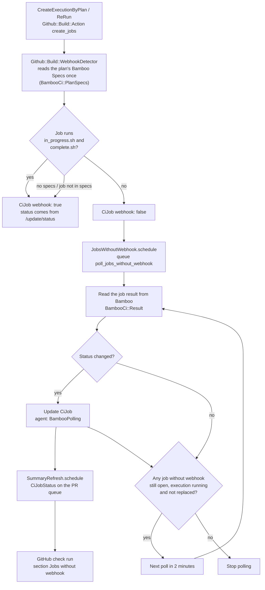
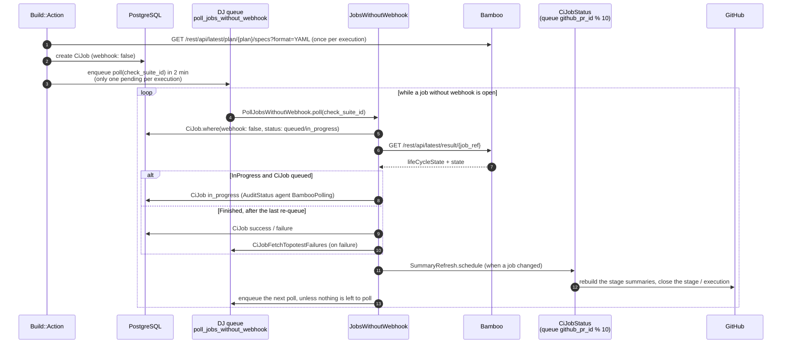

# Jobs without webhook

Some Bamboo jobs never call back the app, because their task list is missing the GitHub Check steps. Without this
feature their `CiJob` stays `queued` until the whole execution finishes, and the stage check run on GitHub shows
them as queued the whole time. The app finds these jobs when it creates an execution, polls Bamboo for their
status, and lists them in the check run summary.

## 1. What makes a job "with webhook"

A Bamboo job reports its status to the app (`POST /update/status`, see
[architecture 5.2](architecture.md#52-progress-callbacks-from-bamboo-post-updatestatus)) only when its task list
runs both of these scripts:

| Task name (in the FRR plans) | Script | Hook sent |
|---|---|---|
| `Github Check - Update` | `ci/github_checks/in_progress.sh` | `in_progress` |
| `Github Check - Complete` | `ci/github_checks/complete.sh` | `success` / `failure` |

The check looks for the script path, not the task name. `Checkout Code` (any job whose name matches `checkout`)
only needs `complete.sh`: `Github::UpdateStatus` already accepts its final status without an `in_progress` hook.
Disabled tasks do not count.

A job that is missing one of the required scripts is a **job without webhook** (`ci_jobs.webhook = false`). Its
status comes from polling Bamboo.

On 2026-11-21, `FRR-PULLREQ3` and `FRR-FRRSECURITYPR` each had 3 jobs like this:
`Ubuntu 26.04 arm8 build`, `Ubuntu 26.04 amd64 build` and `AddressSanitizer Debian 12 amd64 with OpenSSL`.

## 2. Overview



## 3. Polling cycle



Rules:

- **Fail-safe detection.** When Bamboo does not give the plan's specs (missing permission, error, invalid YAML) or a
  job is not in them, the job keeps the webhook behaviour. This is the same behaviour as before the feature.
- **One pending poll per execution.** `JobsWithoutWebhook.schedule` checks `DelayedJobLookup` first and does not
  count the poll that is running (it is still in `delayed_jobs`, locked).
- **Same path as a hook.** A status change schedules `CiJobStatus` through `Github::Build::SummaryRefresh`, as
  `Github::UpdateStatus` does. The stage summaries are rebuilt, and the execution is finished, by the same worker
  and in the same order as for a hook.
- **Retry-safe result.** A result counts only if it finished after the job's last re-queue. The rule comes from
  `Summary::PendingJobs#sync_job`, which the poll reuses. A `ci:retry` schedules polling again for the execution.
- **Stop conditions.** The cycle stops when every job without webhook is final, when the `CheckSuite` has no open
  stage, or when a newer execution of the same plan replaces it.
- **Errors.** An error on one job is logged in `pr<id>.log` and does not stop the chain: the next poll reads it again.

## 4. Check run summary

`Summary::MessageFormatter` adds a section at the end of each stage summary that has jobs without webhook:

```
:warning: Jobs without webhook: 2/24 (status polled from Bamboo)

- **Ubuntu 26.04 amd64 build** (in_progress) -> https://ci1.netdef.org/browse/FRR-PULLREQ3-U2604AMD64-25201
- **Ubuntu 26.04 arm8 build** (success) -> https://ci1.netdef.org/browse/FRR-PULLREQ3-U2604ARM8-25201
```

These jobs are still counted in the queued, in progress, success and failure sections. The new section only shows
that their status comes from polling, and that the GitHub Check tasks are missing in Bamboo.

## 5. Requirements

- The Bamboo user of the app (the `~/.netrc` user, or the service account) needs the **`VIEW_CONFIGURATION`**
  permission on the plans. Without it Bamboo answers `403` to the specs export, and every job keeps the webhook
  behaviour.
- The queue `poll_jobs_without_webhook` must have a worker. The Ansible role runs it in
  `netdef-ci-ruby-worker-jobs-without-webhook.service` (`netdef_ci_job_workers`).

## 6. Code

| Area | File |
|---|---|
| Column `ci_jobs.webhook` (boolean, default `true`) | `db/migrate/20261121120000_add_webhook_to_ci_jobs.rb` |
| Plan specs export and task parsing | `lib/bamboo_ci/plan_specs.rb` |
| Webhook rule per job | `lib/github/build/webhook_detector.rb` |
| Sets `webhook` and schedules polling | `lib/github/build/action.rb` |
| Polling | `lib/github/build/jobs_without_webhook.rb`, `workers/poll_jobs_without_webhook.rb` |
| Summary refresh shared with `/update/status` | `lib/github/build/summary_refresh.rb` |
| Polling again after `ci:retry` | `lib/github/retry/base.rb` |
| Summary section | `lib/github/build/summary/message_formatter.rb` |

## 7. Observability

| Signal | Meaning |
|---|---|
| `ci_jobs_without_webhook_total{plan}` | Jobs created without webhook, by Bamboo plan |
| `bamboo_api_requests_total{operation="fetch_plan_specs"}` | Specs exports (`status="error"` only when the request failed; a `403` is logged in `github_plan_specs.log`) |
| `bamboo_api_requests_total{operation="poll_job_without_webhook"}` | Job result reads made by the polling |
| `logs/github_plan_specs.log` | Specs that Bamboo did not export (with its answer) |
| `logs/github_build_action.log` | Each job flagged without webhook and the scripts it is missing |
| `AuditStatus.agent = 'BambooPolling'` | Status changes made by the polling |
